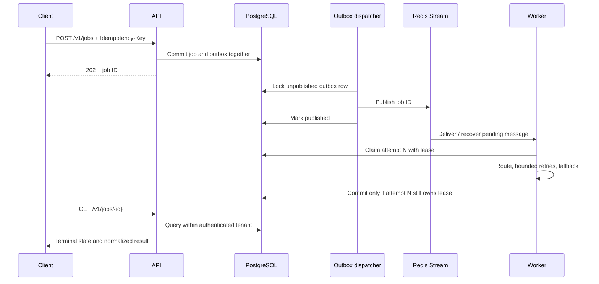

# A five-minute engineering walkthrough

## Problem and scope

A caller submits an AI job, the API commits it, and the queue goes down before publication. A simple `INSERT` followed by `enqueue` can strand accepted work. This project makes PostgreSQL authoritative and commits a job with its outbox row in one transaction. The dispatcher can publish later.

This is a reference implementation for internal applications. Static API keys, application-level tenant filters and example deployment manifests are not a complete hosted multi-tenant security boundary.

## Follow one request through the code

| Step | Implementation | What to inspect |
|---|---|---|
| Validate and authenticate | [`api.py`](../src/gateway/api.py), [`schemas.py`](../src/gateway/schemas.py) | Strict contracts; constant-time key comparison; tenant ID derived from the key; distributed submission limits |
| Deduplicate and accept | [`repository.py`](../src/gateway/repository.py), [`db.py`](../src/gateway/db.py) | Canonical request hash; unique tenant/key identity; job and outbox committed together |
| Publish | [`dispatcher.py`](../src/gateway/dispatcher.py) | PostgreSQL row locks, `SKIP LOCKED`, publish before mark-sent |
| Claim | [`repository.py`](../src/gateway/repository.py) | Row lock; queued or expired running state; monotonically increasing attempt |
| Execute | [`executor.py`](../src/gateway/executor.py), [`routing.py`](../src/gateway/routing.py) | Retry classification, ordered fallback and Decimal cost calculation |
| Commit | [`repository.py`](../src/gateway/repository.py), [`tasks.py`](../src/gateway/tasks.py) | Running state, current attempt and unexpired lease must all match |
| Observe | [`main.py`](../src/gateway/main.py), [`api.py`](../src/gateway/api.py) | Request IDs, provider metrics, HTTP 503 when readiness dependencies fail |

## Run an operational task

Start the local stack from the root README, then use [the executable walkthrough](walkthrough.md). It submits an echo job, polls its result, proves that a repeated key returns the same ID, and proves that a changed body with the same key returns 409. No paid provider credential is needed.

For a second code-reading exercise, inspect `test_reclaimed_lease_rejects_stale_worker` in [`test_repository.py`](../tests/test_repository.py). Two sessions represent different workers: attempt 2 reclaims an expired job, and attempt 1 is unable to replace its result with either stale success or stale failure. That test addresses a specific race; it is not a full broker process-kill qualification.

## Evidence and limits

- The retained [1,000-job report](benchmarks.md) records 84.13 jobs/second with 100 concurrent clients and a deterministic provider. It measures local job reconciliation, not model throughput or a cloud service-level objective.
- CI runs lint, formatting, strict typing and Python tests on 3.11 and 3.12; the fast repository tests use SQLite. SQLite cannot establish PostgreSQL lock contention or Redis redelivery guarantees.
- The coverage configuration excludes transport, API and entry-point modules. Its 85% gate applies to the configured subset, not the entire service.
- PostgreSQL uniqueness and row locks implement the concurrency design. Recovery under a real database failover, Redis data loss and simultaneous process termination still needs environment-specific integration qualification.
- Kubernetes resources are deployment examples, not a record of production deployment.

## Design decisions worth discussing

1. **Outbox versus direct enqueue:** one extra table and a relay avoid a dual-write acceptance gap. Publishing and marking are still separate operations, so duplicates are expected.
2. **Lease plus attempt fence:** availability after worker death requires reclaiming a job. Fencing prevents an old worker from corrupting the authoritative result after reclaim. It cannot revoke an external provider call already in progress.
3. **Cancellation is logical:** a cancelled job cannot be completed in the database, but an in-flight provider request can still finish and incur cost.
4. **Fallback is policy:** a deterministic echo is useful for development. The example `general` route includes it as a fallback; replace that route before serving real inference, otherwise an outage can return synthetic text as a successful result.
5. **API key as tenant identity:** simple for bounded internal use; key rotation changes the derived tenant identity. Stable tenant IDs and per-principal authorization belong in a hosted deployment.
